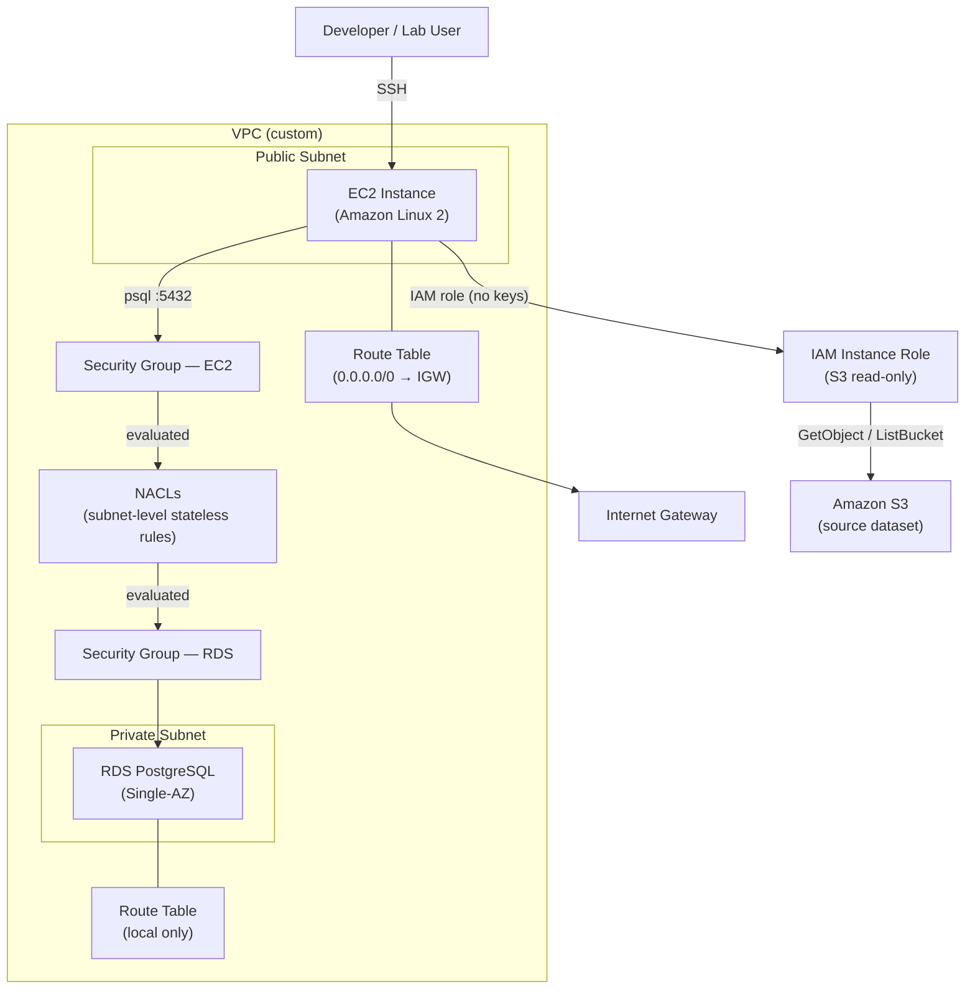

# EC2-to-RDS PostgreSQL Connectivity Lab

> **Lab disclaimer** — This is a structured learning exercise, not a production deployment. All infrastructure is intentionally minimal so that each connectivity layer can be broken and repaired in isolation. Results documented here reflect the lab scenario; your environment will differ.

---

## Overview

This lab practices diagnosing and resolving the most common reasons an Amazon EC2 instance cannot reach an Amazon RDS PostgreSQL database inside the same VPC. The end-to-end workflow is:

1. An EC2 instance downloads a CSV dataset from Amazon S3 using an IAM instance role (no hardcoded credentials).
2. The downloaded file is loaded into an RDS PostgreSQL table via the PostgreSQL server-side `COPY` command.
3. Each networking and security layer between EC2 and RDS is deliberately misconfigured, diagnosed, and fixed.

The dataset used is a movie-ratings table (`ratings_training`) with columns `user_id`, `movie_id`, `rating`, and `timestamp` — a stand-in for any real workload that moves data from object storage into a relational database.

---

## Architecture



---

## What the Lab Sets Up

| Component | Detail |
|---|---|
| VPC | Custom VPC with at least one public and one private subnet |
| EC2 | Amazon Linux 2 in the public subnet; used as the bastion and data-loader host |
| RDS | PostgreSQL (Single-AZ) in the private subnet; not publicly accessible |
| S3 | Existing bucket holding the ratings CSV; accessed via VPC or internet |
| IAM | EC2 instance profile with a scoped S3 policy; no access keys in code |
| Security Groups | Separate SGs for EC2 and RDS, rules deliberately misconfigured for each exercise |
| NACLs | Subnet-level stateless ACLs exercised in at least one lab step |

---

## Connectivity Failure Modes Diagnosed

The lab walks through each layer of the AWS connectivity model in order from most to least commonly misconfigured. Only the layers explicitly covered by the repository's code and notes are listed here.

### 1. Security Groups

**What can go wrong:** The RDS security group does not have an inbound rule on TCP 5432 that references the EC2 security group (or its CIDR). Security groups are stateful — only the inbound rule on the RDS side needs to permit the traffic; the return path is allowed automatically.

**How it was verified:**
```bash
# From the EC2 instance — connection refused or timeout before fix
psql -h <rds-endpoint> -U <db-user> -d <db-name> -p 5432

# AWS CLI — inspect the RDS security group rules
aws ec2 describe-security-groups --group-ids <sg-rds-id>
```
A timeout (no ICMP unreachable) indicates the packet is being silently dropped by a security group rule. A connection-refused error means the packet reached the host but port 5432 is not accepting.

**Fix:** Add an inbound rule to the RDS security group: Type `PostgreSQL`, Protocol `TCP`, Port `5432`, Source = EC2 security group ID (preferred over CIDR for portability).

---

### 2. Subnets and Route Tables

**What can go wrong:** EC2 and RDS are in subnets whose route tables have no path to each other, or the RDS subnet has a route that inadvertently points traffic away from the local VPC CIDR.

**How it was verified:**
```bash
# Confirm EC2 can reach the RDS CIDR at all (VPC-level reachability)
aws ec2 describe-route-tables --filters "Name=association.subnet-id,Values=<rds-subnet-id>"

# Reachability Analyzer (no-charge within same VPC for basic checks)
aws ec2 create-network-insights-path \
  --source <ec2-eni-id> \
  --destination <rds-eni-id> \
  --protocol TCP
aws ec2 start-network-insights-analysis --network-insights-path-id <path-id>
```
All traffic within the same VPC is routed via the implicit local route (`0.0.0.0/local`), so subnet-level routing failures are less common than security-group failures but can occur when custom route tables override the local route or when subnets are in different VPCs without peering.

**Fix:** Confirm both subnets share the same VPC and that the route table for each subnet contains the `local` route entry covering the full VPC CIDR.

---

### 3. Network ACLs (NACLs)

**What can go wrong:** NACLs are stateless. Both the inbound rule on the RDS subnet *and* the outbound rule on the RDS subnet (for the ephemeral-port return traffic) must be present. Missing the outbound ephemeral-port range (`1024–65535`) on the RDS subnet's NACL is a classic silent failure.

**How it was verified:**
```bash
aws ec2 describe-network-acls \
  --filters "Name=association.subnet-id,Values=<rds-subnet-id>"
```
Look at both `Inbound` (allow TCP 5432 from VPC CIDR or EC2 subnet CIDR) and `Outbound` (allow TCP 1024–65535 to the EC2 subnet CIDR). Also check the EC2 subnet's NACL for the mirror rules in the opposite direction.

**Fix:** Add the missing NACL rules for both inbound PostgreSQL traffic and outbound ephemeral-port return traffic, with rule numbers lower than any existing DENY rules.

---

### 4. IAM Roles and Credential Hygiene (EC2-to-S3)

**What can go wrong:** The EC2 instance has no instance profile attached, or the profile's policy lacks `s3:GetObject` / `s3:ListBucket` on the target bucket. A secondary risk is developers hardcoding access keys in scripts or committing them to source control.

**How it was verified:**

The `scripts/download_from_s3.py` script explicitly instructs the user to rely on the instance role rather than hardcoded credentials:

```python
# NOTE: Do NOT hardcode credentials here. Use IAM roles or environment variables.
import os
print('Use env var or IAM role to access S3 securely.')
```

The `.gitignore` enforces that `.env`, `*.pem`, and `*.key` files are never committed:

```
.env
*.pem
*.key
```

Role attachment is verified with:
```bash
aws sts get-caller-identity          # confirms role, not user credentials
curl -s http://169.254.169.254/latest/meta-data/iam/security-credentials/
```

**Fix:** Attach an instance profile to the EC2 instance. The policy should follow least privilege — only the specific bucket ARN and only `s3:GetObject` and `s3:ListBucket`:

```json
{
  "Effect": "Allow",
  "Action": ["s3:GetObject", "s3:ListBucket"],
  "Resource": [
    "arn:aws:s3:::YOUR-BUCKET-NAME",
    "arn:aws:s3:::YOUR-BUCKET-NAME/*"
  ]
}
```

---

## SQL: Table and Data Load

Once connectivity is established, the lab loads the dataset into RDS PostgreSQL.

**Table creation (`sql/ratings_table_ddl.sql`):**
```sql
DROP TABLE IF EXISTS ratings_training;
CREATE TABLE ratings_training (
  user_id   INT,
  movie_id  INT,
  rating    FLOAT,
  timestamp BIGINT
);
```

**Data load (`sql/copy_data.sql`):**
```sql
COPY ratings_training (user_id, movie_id, rating, timestamp)
FROM '/home/ec2-user/data/ratings_ml_training_dataset.csv'
DELIMITER ',' CSV HEADER;
```

The `COPY` command is a PostgreSQL server-side operation — the file path is resolved on the *RDS host*, which means the CSV must first be accessible to the RDS process. In practice for RDS (where direct filesystem access is unavailable), the recommended approach is `\copy` (client-side, psql meta-command) or the `aws_s3` extension for Aurora/RDS S3 imports. The script in this lab copies the file to the EC2 instance first; how it reaches RDS depends on the import method chosen in the lab session.

---

## IAM Least-Privilege Notes

| Principle | Implementation in this lab |
|---|---|
| No long-term credentials in code | `download_from_s3.py` uses instance role; `.gitignore` excludes `.env`, `*.pem`, `*.key` |
| Scope S3 access to specific bucket | Policy should reference the exact bucket ARN, not `arn:aws:s3:::*` |
| RDS not publicly accessible | RDS is in a private subnet; no public IP assigned |
| Least-privilege security groups | RDS SG source should be the EC2 SG ID, not `0.0.0.0/0` |
| No SSH from `0.0.0.0/0` in production | Lab may use broad SSH rules for convenience; tighten to your IP in real deployments |

---

## Cost and Teardown

This lab uses resources that incur AWS charges while running. Estimated costs for a short lab session are low but non-zero.

| Resource | Approximate cost driver |
|---|---|
| RDS PostgreSQL (Single-AZ, db.t3.micro) | ~$0.017/hr (varies by region) |
| EC2 (t2.micro or t3.micro) | ~$0.012/hr; free-tier eligible if within limits |
| S3 storage + requests | Minimal for a single CSV dataset |
| Data transfer (same-region, same-AZ) | Free between EC2 and RDS in same AZ |

**Teardown checklist:**
```bash
# 1. Terminate EC2 instance
aws ec2 terminate-instances --instance-ids <ec2-instance-id>

# 2. Delete RDS instance (skip final snapshot if this is lab data)
aws rds delete-db-instance \
  --db-instance-identifier <rds-id> \
  --skip-final-snapshot

# 3. Delete custom VPC and associated resources (SGs, subnets, IGW, route tables)
#    Use the VPC console or:
aws ec2 delete-vpc --vpc-id <vpc-id>

# 4. Remove the IAM instance profile and role
aws iam remove-role-from-instance-profile --instance-profile-name <profile> --role-name <role>
aws iam delete-instance-profile --instance-profile-name <profile>
aws iam detach-role-policy --role-name <role> --policy-arn <policy-arn>
aws iam delete-role --role-name <role>

# 5. Empty and delete the S3 bucket if created for this lab
aws s3 rm s3://YOUR-BUCKET-NAME --recursive
aws s3api delete-bucket --bucket YOUR-BUCKET-NAME
```

Always verify with `aws rds describe-db-instances` and `aws ec2 describe-instances` that no resources remain running after teardown.

---

## Lessons Learned

1. **Security groups are stateful; NACLs are not.** The most common mistake when NACLs are involved is adding only the inbound rule and forgetting the outbound ephemeral-port return rule.

2. **Timeouts vs. connection refused are different signals.** A timeout means the packet is being dropped (security group, NACL, or wrong endpoint). A `connection refused` means the host is reachable but nothing is listening on the port — check that RDS is running and that you are using the correct port and endpoint.

3. **Instance roles eliminate a whole class of credential-leak bugs.** Every access key that never exists in a script is a key that can never be accidentally committed or rotated incorrectly.

4. **The `COPY` vs. `\copy` distinction matters.** PostgreSQL's server-side `COPY` requires the file to be accessible on the database server's filesystem. For managed RDS, use psql's client-side `\copy` meta-command or the RDS/Aurora S3 import feature.

5. **Reachability Analyzer is a free first step.** Before spending time tracing NACLs and route tables manually, AWS Network Reachability Analyzer can confirm whether a path exists and pinpoint which hop is blocking traffic.

6. **Layer your verification.** Fix one layer at a time (security group → NACL → route table) and retest after each change. Fixing multiple layers simultaneously makes it impossible to know which one was the actual problem.

---

## Repository Structure

```
.
├── README.md                         # This file
├── .gitignore                        # Excludes .env, *.pem, *.key, credentials
├── scripts/
│   └── download_from_s3.py          # Downloads dataset from S3 using IAM role
└── sql/
    ├── ratings_table_ddl.sql         # Creates ratings_training table in RDS PostgreSQL
    └── copy_data.sql                 # Loads CSV data into the table
```

---

## Skills Demonstrated

- Amazon VPC: subnets, route tables, Internet Gateway
- Security Groups (stateful, layer 4) and NACLs (stateless, layer 4)
- Amazon RDS PostgreSQL setup and private-subnet placement
- IAM instance roles and least-privilege S3 policies
- Credential hygiene (no hardcoded keys; `.gitignore` for secrets)
- PostgreSQL DDL (`CREATE TABLE`) and bulk-load (`COPY` / `\copy`)
- AWS CLI and diagnostic commands for connectivity troubleshooting
- boto3 / Python for AWS SDK interactions
